# Gemini 关于 3 例官方公告探测结果的独立穿透复核与边界裁定报告

- **编写主体**：反重力 Gemini 3.8 Flash High
- **研究批次**：[`research/first_board_corporate_action_official_probe_20261021T065629Z/`](file:///d:/Documents/ChatGPT/龙头战法/research/first_board_corporate_action_official_probe_20261021T065629Z/)
- **联合冻结协议**：[`JOINT_FROZEN_PROTOCOL.json`](file:///d:/Documents/ChatGPT/龙头战法/research/first_board_corporate_action_official_probe_20261021T065629Z/JOINT_FROZEN_PROTOCOL.json) (`frozen_at: 2026-10-21T06:56:29Z`)
- **执行会话与收据**：Session 89109 (exit code 0)，[`ALL_THREE_CASE_SOURCE_RECEIPTS.json`](file:///d:/Documents/ChatGPT/龙头战法/research/first_board_corporate_action_official_probe_20261021T065629Z/ALL_THREE_CASE_SOURCE_RECEIPTS.json)
- **字段绑定与初核**：[`OFFICIAL_FIELDS_BOUND_BEFORE_PRICE_COMPARISON.json`](file:///d:/Documents/ChatGPT/龙头战法/research/first_board_corporate_action_official_probe_20261021T065629Z/OFFICIAL_FIELDS_BOUND_BEFORE_PRICE_COMPARISON.json)，[`THREE_CASE_FIELD_AND_PRICE_QUALIFICATION.json`](file:///d:/Documents/ChatGPT/龙头战法/research/first_board_corporate_action_official_probe_20261021T065629Z/THREE_CASE_FIELD_AND_PRICE_QUALIFICATION.json)
- **复核状态**：**独立只读审计闭环，外部 HTTP 请求严格为 0 (`external_requests = 0`)，模型拟合严格为 0 (`model_fits = 0`)，原模型、标签库与生产环境 0 修改**。

---

## 一、 独立审计总体结论与核心认知颠覆

Gemini 独立读取了 2 份官方公告原件文本（`600361_IMPLEMENTATION_TEXT.txt`、`688368_IMPLEMENTATION_TEXT.txt`）、原价格表 [`ADJACENT_PRE_EX_AND_EX_PRICES_NO_TARGETS.csv`](file:///d:/Documents/ChatGPT/龙头战法/research/first_board_corporate_action_official_probe_20261021T065629Z/ADJACENT_PRE_EX_AND_EX_PRICES_NO_TARGETS.csv) 以及历史 33,725 行全量队列文件 [`all_first_and_second_boards_WITH_SEPARATE_LABELS.csv`](file:///d:/Documents/ChatGPT/龙头战法/research/first_second_stage_20261020_run1/all_first_and_second_boards_WITH_SEPARATE_LABELS.csv)，得出以下三项重大定性结论：

### 1. 彻底推翻“普通派现/3种结构100%覆盖”的先验假设
实际官方公告证明：A股市场的公司行动存在大量的**“差异化分红送转（Differential Distribution）”**！
- 由于上市公司普遍存在回购专用证券账户股份、重大资产重组业绩承诺补偿拟回购注销股份或股权激励限售股，这些股份**不享有利润分配和公积金转增权利**；
- 导致实际参与分配的股本数与总股本不一致，必须按照交易所规定折算**虚拟分派每股现金红利**与**虚拟分派流通股份变动比例**；
- **核心结论**：任何直接采用名义每股派现（如 1.00 元）或名义转增比例（如 0.40 股）代入教科书标准公式的算法，在遇到差异化分红时必然计算出错误的法定参考价！

### 2. 发现除权误差导致的首板候选漏入（Candidate Pool Omission）
`600361 创新新材` 在 2024-06-28 当日，官方参考价公式计算出的涨停上限正好为 4.03 元，实际收盘价亦为 4.03 元，法定涨停成立；且当日原始首板行情源亦明确记录其为 `XD创新新`。然而：
- 在项目原 33,725 行历史两阶段队列中，`600361` 在 `2024-06-28` 的记录行数**严格为 0 行**！
- 原因是在构建候选池时，使用了简单移位公式 `pre_close = shift(1) = 3.73`，导致名义涨停上限被误算为 4.10 元，实际收盘 4.03 元被误判为未涨停（仅涨 8.04%），从而将该合规首板**完全遗漏在候选池之外**；
- **定性原则**：这是除权价格错误导致的**首板候选漏入（Candidate Pool Omission）**证据，绝非 target 标签 0 转 1，因为目前尚未读取其作为首板后的次日晋级真实结果。

### 3. 严格恪守未知边界，反对经验主义泛化
- `603203 快克智能` 在 1 次有界 25 条索引中未命中实施公告，严格标记为 `UNKNOWN`，绝不断言其“未分红”，绝不无界重试；
- 索引接口 pageSize=100 但单页仅返 30 条且 `index_has_more: true`，证实单次有界索引无法覆盖公司全量历史公告，严禁宣称公告全覆盖。

---

## 二、 3 例标的官方公告与价格穿透复核明细

### 1. 标的 1：`600361 创新新材`（2024-06-28，XD，主板 10%）

| 审核项目 | 官方公告 / 数据源事实 | Gemini 独立复核判定 |
| :--- | :--- | :--- |
| **公告编号与日期** | 临 2024-029，披露于 2024-06-24（PDF: `1220436893.PDF`，SHA-256: `df177...`） | 确认无误，公告文本完整性通过 |
| **关键除权日期** | 股权登记日：2024-06-27；除权（息）日：2024-06-28 | 确认与原行情时钟完全对应 |
| **股本与差异化事实** | 总股本 4,336,192,838 股，扣除业绩补偿拟回购注销股 228,756,953 股，实际参与分配股本 4,107,435,885 股；每股派现 0.07 元（含税） | 确认属于**差异化分红** |
| **虚拟现金与官方公式** | 虚拟现金红利 $= \frac{4,107,435,885 \times 0.07}{4,336,192,838} \approx 0.0663$ 元/股；但公司公告明确写明：**除权除息参考价 $= (\text{前收盘价格} - 0.07)$** | **公司官方明确指定了参考公式**：以 0.07 作为扣减值 |
| **基准价格与涨停上限** | 2024-06-27 原始收盘价：$3.73$ 元； 官方参考价：$P_{\text{ref}} = 3.73 - 0.07 = 3.66$ 元； 法定 10% 涨停上限：$\text{round}(3.66 \times 1.10, 2) = \mathbf{4.03}$ 元 | 官方公式法定涨停上限为 **4.03 元** |
| **原始移位公式对比** | 移位前收 $3.73$ 元； 名义涨停上限：$\text{round}(3.73 \times 1.10, 2) = \mathbf{4.10}$ 元 | 移位上限高出 0.07 元，产生失真 |
| **当日实际收盘与涨停性** | 2024-06-28 实际收盘价：$\mathbf{4.03}$ 元 | **实际收盘 100% 匹配官方涨停上限 4.03 元**；若按移位公式则误判为未涨停 |
| **33,725 全量队列穿透** | 在 `all_first_and_second_boards_WITH_SEPARATE_LABELS.csv` 中检索 `600361` 在 `2024-06-28`：**记录数为 0** | **确认为首板漏入反例**；原始源记录为 `XD创新新` |

### 2. 标的 2：`688368 晶丰明源`（2026-06-09，DR，科创板 20% 规则对照）

| 审核项目 | 官方公告 / 数据源事实 | Gemini 独立复核判定 |
| :--- | :--- | :--- |
| **公告编号与日期** | 临 2026-042，披露于 2026-06-03（PDF: `1225347015.PDF`，SHA-256: `e4c6e...`） | 确认无误，科创板公告结构完备 |
| **关键除权日期** | 股权登记日：2026-06-08；除权（息）日：2026-06-09 | 确认无误 |
| **股本与差异化事实** | 总股本 145,714,693 股，扣除回购专户 913,580 股，实际参与分配 144,801,113 股；每 10 股派 10 元（每股 1.00 元），每 10 股转增 4 股（每股 0.40 股） | 确认属于**差异化分红送转（复合DR）** |
| **虚拟参数法定折算** | 虚拟现金红利 $= \frac{144,801,113 \times 1.00}{145,714,693} \approx \mathbf{0.9937}$ 元/股； 虚拟转增比例 $= \frac{144,801,113 \times 0.40}{145,714,693} \approx \mathbf{0.3975}$ | 严格依照上交所自律监管指引计算，数值完全一致 |
| **官方公告参考价公式** | 官方公告明确裁定： $$P_{\text{ref}} = \frac{P_{\text{close}} - 0.9937}{1 + 0.3975} = \frac{\mathbf{P_{\text{close}} - 0.9937}}{\mathbf{1.3975}}$$ | **彻底推翻教科书公式 $\frac{P_{\text{close}} - 1.00}{1.40}$** |
| **主板数据与隔离状态** | 主板日线行情库中无 688368 对应行情，实际数值 cap 保持未知 | **维持科学隔离，严禁将该科创板股票注入主板 10% 训练池** |

### 3. 标的 3：`603203 快克智能`（2026-06-08，DR，主板 10%）

| 审核项目 | 官方公告 / 数据源事实 | Gemini 独立复核判定 |
| :--- | :--- | :--- |
| **索引检索结果** | 单次有界索引检索返回 25 条公告，其中无权益分派实施公告 | 事实确凿，索引未命中 |
| **状态判定** | 状态锁定为：`NO_IMPLEMENTATION_IN_BOUNDED_INDEX_UNKNOWN` | **客观未知（UNKNOWN）** |
| **推论限制** | 绝不能因未检索到实施公告就推定“未实施分红送转”；亦不得擅自开启循环抓取 | 恪守有界原则，不进行非受控网络重试 |

---

## 三、 对除权除息算法与数据集缺陷的重大定性

结合爱婴室 `603214` 与创新新材 `600361`，除权除息未复权对机器学习数据集构成了**两类完全不同的破坏机制**：

```mermaid
flowchart TD
    subgraph S1["破坏机制 1：首板候选漏入 (Candidate Omission)"]
        A1["信号日 S 当日除权 (如 600361)"] --> B1["未扣减现金红利，pre_close 偏高"]
        B1 --> C1["计算所得法定涨停价 Cap 偏高 (4.10)"]
        C1 --> D1["实际收盘价 (4.03) 被误判为未涨停 (+8.04%)"]
        D1 --> E1["导致真实首板股票在 S 日未能进入 33725 队列 (0行)"]
    end

    subgraph S2["破坏机制 2：目标标签误标 (Target Misclassification)"]
        A2["目标日 S+1 当日除权 (如 603214)"] --> B2["S 日首板已入池，但 S+1 移位 pre_close 偏高"]
        B2 --> C2["S+1 计算所得涨停价 Cap 偏高"]
        C2 --> D2["S+1 实际二板涨停被误判为普通收盘"]
        D2 --> E2["导致真实二板晋级被误标为 Y=0"]
    end
```

**红线禁令**：
1. **不能将候选漏入冒称为标签更正**：`600361` 是候选行缺失，在未按统一流程审查其次日真实表现前，绝不能直接将其算作晋级正例或改写任何历史账本；
2. **不能用普通分红公式强行推导全库**：`688368` 差异化分红的虚拟参数证明，任何缺少虚拟稀释参数的第三方分红数据，直接套用均会带来新的参考价计算偏差。

---

## 四、 产物清单与文件哈希核验

- 本报告：[`GEMINI_OFFICIAL_THREE_CASE_REVIEW.md`](file:///d:/Documents/ChatGPT/龙头战法/research/first_board_corporate_action_official_probe_20261021T065629Z/gemini/GEMINI_OFFICIAL_THREE_CASE_REVIEW.md)
- 结构化核验证据：[`GEMINI_OFFICIAL_THREE_CASE_REVIEW.json`](file:///d:/Documents/ChatGPT/龙头战法/research/first_board_corporate_action_official_probe_20261021T065629Z/gemini/GEMINI_OFFICIAL_THREE_CASE_REVIEW.json)
- 本次审计执行严格为：`model_fits = 0`，`external_requests = 0`，生产文件写入为 0。
