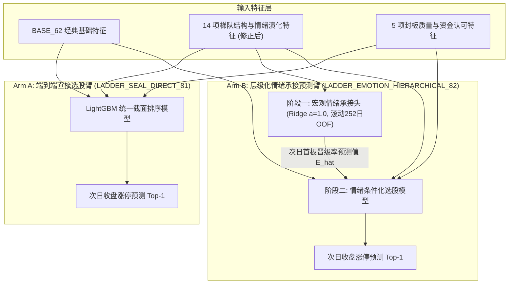

# Gemini 梯队结构、封板质量与情绪承接预测头联合设计方案

- **编写主体**：反重力 Gemini 3.8 Flash High
- **研究批次**：[`research/gemini_codex_joint_ladder_emotion_design_20261021T071259Z/`](file:///d:/Documents/ChatGPT/龙头战法/research/gemini_codex_joint_ladder_emotion_design_20261021T071259Z/)
- **前序状态**：除权公告外延扩采已按用户最高优先级正式中止（`DEFERRED_BY_LATEST_USER_PRIORITY.json`，`0 HTTP / 0 fit`）；研究焦点全面回归实际选股训练与情绪梯队。
- **核心任务**：响应用户“连板和首板最重要的是梯队，封板质量还有情绪”及“最重要的是要精准判断情绪”的根本指示，对 Codex 初步提出的 14 项梯队情绪指标、5 项封板质量指标以及两臂设计架构进行独立反驳、去重、漏洞修正与方案共识。
- **本批状态**：**纯方案设计与特征定义阶段，模型拟合严格为 0 (`model_fits = 0`)，网络请求严格为 0 (`external_requests = 0`)，原模型/标签/账本 0 篡改**。

---

## 一、 14 项梯队与情绪演化特征的数学漏洞修正与去重审计

针对 Codex 提出的 14 项候选梯队特征，Gemini 进行逐项数学检验，指出必须修正的 **3 项重大数值定义漏洞** 及与原 BASE_62 的重叠关系：

### 1. 必须修正的 3 项数学漏洞与未定定义

#### 漏洞 1：断层比例（`ladder_gap_ratio`）的分母为零与负值缺陷
- **缺陷表现**：若简单定义为“2 至最高板之间的空缺层数 / (最高板 - 2)”，当市场处于极弱期或首板爆发期（即 `market_max_height == 1` 或 `2`）时，分母为 $-1$ 或 $0$，将引发除零崩溃或荒谬的负断层率。
- **Gemini 严谨数学定义**：
  $$\text{ladder\_gap\_ratio} = \begin{cases} 
  0.0, & \text{if } \text{market\_max\_height} \le 2 \\
  \frac{\sum_{k=2}^{\text{market\_max\_height}-1} \mathbb{I}(n_k == 0)}{\text{market\_max\_height} - 2}, & \text{if } \text{market\_max\_height} \ge 3
  \end{cases}$$
  当最高板 $\ge 3$ 时，精准衡量 2 板至顶板之间中间身位的断护送比例（断层越高，高标越孤立无援）。

#### 漏洞 2：分身位存活率在空样本日被误置为 0.0（混淆“全军覆没”与“历史无样本”）
- **缺陷表现**：若昨日没有 3 板股票（$n_{3, \text{prev}} = 0$），今日的“3进4存活率”如果填入 $0.0$，树模型将把“昨日根本没有 3 板”错误等同于“昨日 3 板今日全部跌死崩盘”！这会严重扭曲极度冰点和快速轮动期的情绪反馈。
- **Gemini 严谨数学定义**：
  若昨日该身位成员数 $n_{k, \text{prev}} == 0$，则昨日 $k$ 进 $k+1$ 存活率**严格赋值为 `NaN`（由 GBDT 原生处理缺失值分支），严禁填充 0.0**！
  - `yesterday_tier2_survival_rate`：仅当 $n_{2, \text{prev}} > 0$ 时计算 $\frac{n_{2 \to 3}}{n_{2, \text{prev}}}$，否则 `NaN`；
  - `yesterday_tier3_survival_rate`：仅当 $n_{3, \text{prev}} > 0$ 时计算 $\frac{n_{3 \to 4}}{n_{3, \text{prev}}}$，否则 `NaN`；
  - `yesterday_tier4plus_survival_rate`：仅当 $n_{4+, \text{prev}} > 0$ 时计算 $\frac{n_{4+ \to 5+}}{n_{4+, \text{prev}}}$，否则 `NaN`。

#### 漏洞 3：连板池“大面比例”（`big_loss_ratio`）的客观界定
- **缺陷表现**：“大面”在论坛中多为主观叙述，若阈值随意摇摆（如 $-5\%$、$-7\%$ 或跌停），会导致指标过拟合。
- **Gemini 严谨数学定义**：
  统一采用短线极端亏钱效应的标准定义：**昨日连板股票在今日收盘收益率 $\le -5.0\%$ 的只数占比**：
  $$\text{yesterday\_relay\_big\_loss\_ratio} = \begin{cases}
  \frac{\sum_{i \in \text{Relay}_{\text{prev}}} \mathbb{I}(\text{return}_{i, \text{today}} \le -0.05)}{|\text{Relay}_{\text{prev}}|}, & \text{if } |\text{Relay}_{\text{prev}}| > 0 \\
  \text{NaN}, & \text{if } |\text{Relay}_{\text{prev}}| == 0
  \end{cases}$$

### 2. 与原 BASE_62 的重叠关系与信息增益剖析

| 候选新指标 | BASE_62 中已有字段 | 重叠程度 | 独立增益与新信息 |
| :--- | :--- | :---: | :--- |
| `n2, n3, n4, n5+` | `market_relays` | 线性分解 | 原 62 仅有一个连板总数（$n_2+n_3+n_4+n_{5+}$），无法区分是“2板堆积的倒金字塔”还是“健康递减的正金字塔”。细分层数具有高阶结构增益。 |
| `ladder_continuous_depth` | `market_max_height` | 条件补充 | 原 62 仅有孤立的最高板绝对高度；新指标测量从 2 板起无缝连接的深度，识别“虚高”与“实梯”。 |
| `ladder_gap_ratio` | 无 | 0% | 原 62 完全缺失中位断层信息。 |
| 分层存活率（2进3、3进4、4+进5+） | `previous_relay_promotion` | 细化分解 | 原 62 将所有连板晋级混为一个平均值；而短线生态中“二进三”是接力分水岭，拆分后能精准捕捉中位接力情绪。 |
| `yesterday_relay_big_loss_ratio` | `previous_top_broken` | 结构互补 | 原 62 仅记录最高板个股是否断板；新指标反映整个连板群体的亏钱效应广度。 |
| 3日动量差值（`delta3`） | 无 | 0% | 原 62 均为当期静态截面截点；新指标刻画情绪修复、发酵或退潮的**一阶导数路径**。 |

---

## 二、 5 项封板质量指标与旧失败试验的根本区别

在旧试验中，封板指标曾遭遇惨痛失败：
- **旧 64 臂（`SEAL_TIME_64`）**：单加首封时间，首板命中数由 BASE 的 52 暴跌至 **40**（净亏 12 次）；
- **旧 66 臂（`SEAL_TIME_FUND_66`）**：加封单资金比，非一字命中数由 48 跌至 **41**；
- **旧 63/67 臂**：单加开板炸板标记，均未通过。

### 为什么旧试验会失败？
因为**在没有梯队和情绪路径约束下，封板时间与资金是严重的“亲周期顺周期陷阱（Procyclical Trap）”**：
- 在情绪退潮期（高位大面、断层严重），9:30 快速秒封或巨额封单往往是机构或游资诱多出货的幌子，次日极易遭遇核按钮；
- 在情绪冰点转折期（分歧转一致），下午 14:00 历经充分换手后封板的标的，反而是带动板块穿越周期的真龙头！
- **旧试验将首封时间作为全局静态无条件特征，迫使模型认为“早封恒优”，因而被退潮期的早封诱多严重误导**。

### 本次设计的关键转变：
本次 5 项封板质量指标（`qualified_first_seal_minute`、`seal_minute_rank`、`closing_seal_ratio_amount`、`closing_seal_ratio_mcap`、`provider_reopened_flag`）必须**置于梯队结构和情绪路径的强约束条件之下**，让决策树学习“在退潮期重视换手与防炸板，在主升期重视早封与封单硬度”的条件交互逻辑。

---

## 三、 两臂设计架构大辩论：保留“情绪预测头” vs “先做封板消融”？

Codex 提出了核心抉择：
- **架构方案甲**：Arm A（梯队情绪+封板 直接选股）vs Arm B（梯队情绪+封板 + **事前次日首板晋级率情绪预测头**）；
- **架构方案乙**：Arm 1（BASE + 梯队情绪）vs Arm 2（BASE + 梯队情绪 + 封板质量）。

Gemini 经过深度量化建模论证，提出如下**鲜明而坚决的独立裁定**：

### 1. 强烈建议保留“情绪预测头（Arm B）”的三大不可替代理由

#### 理由 1：直接响应用户最核心的指令——“最重要的是要精准判断情绪”
如果采用方案乙（仅做封板特征消融），我们依然只是把梯队指标当成一堆死特征扔给树模型去贪心分裂，**整个系统根本没有任何一个模块在输出“对情绪的精准判断”**，也没有任何客观指标能衡量“情绪判断得准不准”！
- Arm B 设立了独立的宏观情绪承接预测头 $\hat{E}_{S+1}$，通过滚动 252 日样本事前预测次日首板池晋级率；
- 能够输出独立的 MAE、RMSE 评估指标，直接回答用户：**模型对市场情绪的判断到底达到了多高的精度**。

#### 理由 2：解决截面样本量（$N \approx 42$）对时间序列（$T = 668$）的方差淹没
在首板选股的 28,503 行数据中，日内截面样本数（平均每日 42 只首板）远大于宏观日期数（668 天）。
- 单阶段扁平 GBDT 在计算分裂增益时，天然偏向于能够区分“股票 A 与股票 B”的截面特征（如换手、量比、流通市值），而严重低估每日仅变化一次的宏观梯队特征；
- 采用层级化（Hierarchical）的两阶段设计，先由岭回归（Ridge $\alpha=1.0$）将宏观梯队信息提炼为 1 维校准后的情绪承接先验 $\hat{E}_{S+1}$，再注入截面排序，能够从根本上防止宏观信号被微观噪声淹没。

#### 理由 3：严格杜绝未来标签穿越的 OOF 架构已完备
Codex 提出的滚动 252 日、按月向前 OOF（至少 63 日冷启动，NaN 保持，训练集 end 严格早于预测 cut，2025H1 仅用 pre2025 权重），在数学因果律上完全无懈可击，不存在任何未来数据泄漏。

---

### 2. 警惕“封板噪声污染”的风险控制方案

然而，Gemini 必须指出方案甲的一个**潜在隐患**：
如果在 Arm A 和 Arm B 中都**强行打包加入 5 项封板特征**，万一封板特征在局部区间依然存在噪声干扰，导致 Arm A 和 Arm B 最终得分均低于 BASE（例如都只有 45 命中），我们就会面临**“因封板噪声拖累，导致无法分辨是梯队情绪无效，还是封板特征再次害了模型”**的混杂归因困境！

### 3. Gemini 推荐冻结的最终两臂方案（锐度最高的对照组）

为彻底兼顾“情绪精准预测”与“因果归因清晰”，Gemini 建议共同冻结如下两臂：

- **Arm A（`LADDER_SEAL_DIRECT_81`，共 81 维特征）**：
  $\text{BASE\_62} + 14 \text{ 项修正梯队情绪指标} + 5 \text{ 项合格封板指标}$，由单阶段模型直接预测个股涨停；
- **Arm B（`LADDER_EMOTION_HIERARCHICAL_82`，共 82 维特征）**：
  在 Arm A 的 81 维输入基础上，**额外注入由阶段一严格 OOF 预测的次日情绪承接先验值 $\hat{E}_{S+1}$**；
- **核心对比检验点**：
  1. **首要验证**：Arm B 对比 Arm A，能否证明“显式精准预测次日情绪承接头”能为个股 Top-1 涨停命中率带来显著提升；
  2. **情绪头独立质检**：阶段一输出 $\hat{E}_{S+1}$ 对真实晋级率的 MAE / RMSE，不自贴标签，用真实数据检验情绪预测准确度；
  3. **终局门槛不变**：全量未知分母保留，117 日验证集及 14 个月滚动外推评估，Top-1 $\ge 60\%$ 原红线绝不放宽。

---

## 四、 结论与状态迁移

- Gemini 已完成对 14 项梯队特征与 5 项封板特征的漏洞修正与因果剖析；
- 正式确立保留“次日首板池晋级率情绪承接预测头”作为 Arm B 的核心突破口；
- 本文档与对应的结构化 JSON 已落盘于 [`research/gemini_codex_joint_ladder_emotion_design_20261021T071259Z/gemini/`](file:///d:/Documents/ChatGPT/龙头战法/research/gemini_codex_joint_ladder_emotion_design_20261021T071259Z/gemini/)，等待 Codex 核对去重与特征资格后，共同签署正式冻结协议开启训练。
