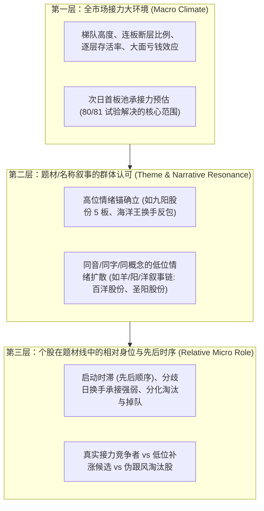

# Gemini 题材情绪与全市场梯队范围抉择及动态叙事增量设计报告

- **编写主体**：反重力 Gemini 3.8 Flash High
- **研究批次**：[`research/gemini_codex_joint_ladder_emotion_design_20261021T071259Z/`](file:///d:/Documents/ChatGPT/龙头战法/research/gemini_codex_joint_ladder_emotion_design_20261021T071259Z/)
- **用户最新指示**：“还有不止梯队的还有题材情绪，比如海洋王，九阳，百洋这些”。
- **对审文件**：[`LATEST_USER_THEME_EMOTION_STEERING.md`](file:///d:/Documents/ChatGPT/龙头战法/research/gemini_codex_joint_ladder_emotion_design_20261021T071259Z/LATEST_USER_THEME_EMOTION_STEERING.md)
- **协议状态**：**正式明确保持 80/81 作为全市场梯队情绪子试验，同时提出动态叙事扩散增量设计（AGREED_ON_THEME_SCOPE_DECISION_BEFORE_FIT），当前模型拟合严格为 0 (`model_fits = 0`)，网络请求严格为 0 (`external_requests = 0`)**。

---

## 一、 市场情绪的三层结构与科学定性

用户明确指出“还有不止梯队的还有题材情绪，比如海洋王，九阳，百洋这些”。Gemini 完全认同这一重要纠偏，并在理论与架构上正式确立**短线市场情绪的三层递进结构**：

**红线禁令**：
- **绝对不能把“全市场首板晋级率预测（Arm B）”冒称为“已经彻底解决了全部情绪问题”**！
- 80/81 两臂的定位**严格且诚实地限定为“第一层：全市场梯队结构与宏观接力承接力”的基石子试验**。

---

## 二、 范围抉择：为什么 80/81 必须先行作为公平对照组？

针对 Codex 提出的抉择问题（“是 80/81 先行跑出基准，还是等待全量题材字段重置两臂”），Gemini 给出明确且坚决的独立裁定：**80/81 必须先行启动实训，绝不能为了等待全历史题材数据而推迟甚至禁止合法的市场梯队子试验！**

### 核心论据：
1. **恪守用户行为准则（`AGENTS.md`）的刚性约束**：
   用户规则明确规定：“缺历史题材只约束相关字段，不阻止合格的历史价量研究”；“不能为了等题材就把合法市场子试验禁止，不能偷加第三臂”。
2. **缺乏全历史 668 日时点合格的题材金标准**：
   目前我们仅对 2024 年 10 月局部日期（如 10月9日–10月14日九阳—百洋链、10月20日海洋王复盘）拥有高精度的论坛与时序核验；而全量 28,503 行跨越 668 个官方交易日，**全历史点位动态题材与角色字段尚无完备时序归档**。
   若强行在当前数值批次加入未经验证的题材特征，将违反“无时序真值不进主训练库”的根本红线。
3. **因果隔离与基准锚定价值**：
   80/81 两臂的特征资格已在 [`LADDER_EMOTION_QUALIFICATION.json`](file:///d:/Documents/ChatGPT/龙头战法/research/gemini_codex_joint_ladder_emotion_design_20261021T071259Z/LADDER_EMOTION_QUALIFICATION.json) 中完成全量 28,503 行、668 日 100% 校验（`0 fit / 0 HTTP`）。
   先跑出 80/81 的纯净对照组，能为后续引入题材情绪特征提供一把**绝对干净的度量衡**：后续任何题材模块的加入，唯有在 80/81 的基准上实现 Top-1 增益，才能确证题材情绪的因果有效性！

---

## 三、 动态题材叙事与活跃锚扩散模型设计（区别于旧 17 静态名称）

为落实用户的深层期望，Gemini 独立提出一套**严格遵循时序因果的动态叙事扩散模型规范**，彻底与此前失败的 17 项静态名称因子划清界限：

### 1. 为什么旧 17 静态名称因子必然失败？
- 旧 17 名称因子采用全局静态哑变量（如“是否含科技”、“是否含智能”、“是否含股份”），属于**脱离具体时间、脱离高标锚点、无市场情绪交互的静态文字挖掘**；
- 静态名称本身不具备预测能力，只有当**市场上出现了一个打出高度的高位情绪锚**时，名称与题材联想才会成为资金借势扩散的催化剂。

### 2. 新动态活跃锚扩散模型的四大因果支柱
1. **时点活跃情绪锚认定（Point-in-Time Active Anchor）**：
   在信号日 $S$，扫描全市场板位 $\ge 3$ 或连续换手涨停的领涨股作为当期活跃锚 $A_t$（如 2024-10-09 九阳股份达成 5 板）；
2. **跨行业叙事与同音同字扩散（Dynamic Cross-Industry Resonance）**：
   从首板候选池中提取与活跃锚具有音韵（羊/阳/洋）、字辈或特定题材语义关联的个股集合 $\mathcal{C}(A_t)$（如百洋股份、圣阳股份、海洋王）；
3. **相对时序与地位（Relative Status & Lag）**：
   - 记录该候选个股相较于活跃锚的**启动时滞（Launch Lag）**；
   - 记录该股在首板日的**换手率偏离度与首封速度相对排名**；
   - 区分“同步共振首板”与“高位断板后的低位补涨切换”；
4. **必须包含的反例、失败样本与未知标记（Strict Negative Cases）**：
   - 必须完整纳入同线未晋级、未涨停的反例（如杭城小七哥复盘中明确指出的读者传媒等失败案例，以及同为“阳”字辈却次日大面的股票）；
   - 绝不能事后挑拣胜者（如不能因为百洋走出来了就只选百洋，忽略同日冲高回落的其他跟风股）；
   - 晚取得的论坛复盘帖子（如 10月20日帖子）仅用于启发假设，绝不倒填历史信号时钟。

---

## 四、 结论与共识

1. **当前批次范围**：
   **正式确认 80/81 两臂作为当前全市场梯队与情绪承接的公平对照实验**，Gemini 负责 Arm A，Codex 负责 Arm B；
2. **题材情绪规划**：
   本批次完成后，立即基于上述动态活跃锚扩散模型，在具备合格时点字段的前提下开展第二层题材情绪的增量试验；
3. **红线保持**：
   绝不擅自添加第三臂，绝不重跑静态名称，绝不回填未来父锚。
