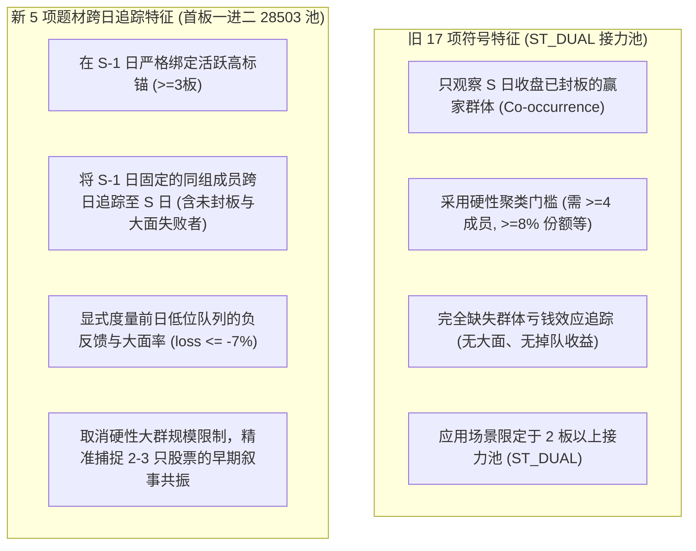

# Gemini 前日活跃锚跨日追踪与题材情绪反馈独立设计方案

- **编写主体**：反重力 Gemini 3.8 Flash High
- **研究批次**：[`research/gemini_codex_joint_theme_feedback_design_20261021T074448Z/`](file:///d:/Documents/ChatGPT/龙头战法/research/gemini_codex_joint_theme_feedback_design_20261021T074448Z/)
- **前序结算收据**：前序批次已正式闭环（[`research/gemini_codex_joint_ladder_emotion_20261021T073604Z/completion.json`](file:///d:/Documents/ChatGPT/龙头战法/research/gemini_codex_joint_ladder_emotion_20261021T073604Z/completion.json)），Arm A 52 次平 BASE，Arm B 47 次回撤，`selected = null`，14 个月月度拟合数为 0。
- **对审文件**：[`DESIGN_SCOPE_BEFORE_FEATURE_RESULTS.json`](file:///d:/Documents/ChatGPT/龙头战法/research/gemini_codex_joint_theme_feedback_design_20261021T074448Z/DESIGN_SCOPE_BEFORE_FEATURE_RESULTS.json)，[`OLD17_ACTUAL_CODE_CORRECTION_BEFORE_NEXT_THEME_DESIGN.md`](file:///d:/Documents/ChatGPT/龙头战法/research/gemini_codex_joint_ladder_emotion_design_20261021T071259Z/OLD17_ACTUAL_CODE_CORRECTION_BEFORE_NEXT_THEME_DESIGN.md)
- **协议状态**：**设计讨论闭环，模型拟合严格为 0 (`model_fits = 0`)，网络请求严格为 0 (`external_requests = 0`)**。

---

## 一、 对前序批次实测结果的客观反思与修正

在进入新题材设计前，Gemini 严格依据前序批次的只读诊断收据 [`ADDITIONAL_FROZEN_TRAINING_MEAN_REFERENCE_DIAGNOSTIC.json`](file:///d:/Documents/ChatGPT/龙头战法/research/gemini_codex_joint_ladder_emotion_20261021T073604Z/LADDER_EMOTION_HIERARCHICAL_81/ADDITIONAL_FROZEN_TRAINING_MEAN_REFERENCE_DIAGNOSTIC.json) 对前述分析进行**客观方法论纠正与事实补正**：

1. **纠正对宏观情绪头“强/显著预测力”的过度断言**：
   - 诊断事实：在 2025H1 验证集的 116 个配对交易日中，pre-2025 历史固定均值（0.20409）的 MAE 为 **0.07039**、RMSE 为 **0.09327**；
   - 而滚动 Ridge 模型的 MAE 为 **0.07241**、RMSE 为 **0.09567**；
   - **客观定性**：Ridge 情绪头虽然击败了滞后一阶的 naive 持续性基准（MAE 0.1016），但**其预测误差实际上略劣于简单的静态历史均值**！此前断言其具备“强/显著预测力”缺乏充分对照依据，特此客观纠正。
2. **纠正对个股命中率下滑的因果臆测**：
   - Arm B 个股选股命中数从 BASE 的 52 次滑落至 47 次，其确凿结论是“注入该宏观估计值未能为截面排序带来增益，反而引入了负向扰动”；此前推断为“树模型阈值抑制”属于未经验证的主观归因，在此收回，严格保持对实测数据的客观陈述。

---

## 二、 旧 17 项符号特征的真实代码真相与新 5 项的本质差异

深入查阅 [`historical_symbolic_context.py`](file:///d:/Documents/ChatGPT/龙头战法/historical_symbolic_context.py) 与 [`symbolic_name_theme_v217.py`](file:///d:/Documents/ChatGPT/龙头战法/symbolic_name_theme_v217.py) 源码后，Gemini 确认：**旧 17 绝非粗糙的静态字符串匹配，而是一套已有较为严密时序与同音聚类（含“阳洋羊扬”等）的算法系统**。

为杜绝“换名重跑旧因子”，必须在理论与代码机制上彻底厘清**新 5 项题材反馈特征与旧 17 项的四大本质区别**：

| 维度 | 旧 17 项符号特征（`historical_symbolic_context.py`） | 本次拟议的新 5 项题材反馈特征 |
| :--- | :--- | :--- |
| **观察视口（Observation Window）** | **截面同日（Day $S$ 静态）**：统计 $S$ 日收盘同时封板的首板/连板数量 | **跨日因果追踪（Day $S-1 \to S$）**：固定 $S-1$ 日已知成员，追踪其在 $S$ 日的真实价量演化 |
| **负反馈与失败者可见性** | **完全不可见**：只统计当天封板成功的成员，完全忽略同组冲高回落或跌停的股票 | **完全可见**：必须包含前日成员在今日**未封板、掉队乃至被核按钮（$\le -7\%$ 大面）**的真实表现 |
| **成组门槛限制** | **硬性门槛筛选**：要求群成员 $\ge 4$ 只、市场份额 $\ge 8\%$、连板数 $\ge 2$ 等，导致早期雏形被大量过滤 | **零门槛锚点驱动**：只要 $S-1$ 存在 $\ge 3$ 板活跃锚即触发追踪，能捕捉如“九阳—百洋”这类仅有 2–3 只标的的早期扩散 |
| **应用样本池** | 原用于 2 板以上接力池（`ST_DUAL`） | 首次部署于**全量 28,503 行首板一进二主板样本池** |

---

## 三、 新 5 项题材反馈特征的严谨数学定义与防污染红线

Gemini 审阅并完全赞成 Codex 提出的 5 项特征架构，并追加如下**数值边界与异常处理约束**：

### 1. 五项特征的精准数学形式

1. **`prior_name_anchor_present`（前日活跃锚存在标志）**：
   $$\text{prior\_name\_anchor\_present} = \begin{cases} 1, & \text{if } \exists \, a \in \text{Family}(i) \text{ s.t. } \text{height}_{a, S-1} \ge 3 \\ 0, & \text{otherwise} \end{cases}$$
2. **`name_anchor_current_mean_return`（前日活跃锚今日平均收益）**：
   在 $S-1$ 日高度 $\ge 3$ 的所有前日锚点股票，在 $S$ 日的平均涨跌幅。
   - **红线**：若 `prior_name_anchor_present == 0`，该值**严格赋值为 `NaN`（绝不能填 0.0）**。
3. **`name_anchor_current_limit_survival`（前日活跃锚今日连板存活率）**：
   前日锚点股票在 $S$ 日维持收盘涨停的比例（即是否继续连板）。
   - **红线**：若无前日锚点，严格赋值为 `NaN`。
4. **`name_prev_followers_current_mean_return`（前日同组低位队列今日平均收益）**：
   在 $S-1$ 日处于 1 板或 2 板的同组跟随个股，在 $S$ 日的平均涨跌幅（**计算必须严格排除候选股票 $i$ 自身，即 Leave-One-Out**）。
   - **红线**：若前日低位跟随队列为空，严格赋值为 `NaN`。
5. **`name_prev_followers_current_loss7_share`（前日同组低位队列今日大面率）**：
   前日低位跟随队列在 $S$ 日收盘跌幅 $\le -7.0\%$ 的个股占比（衡量该题材内部的短线亏钱效应）。
   - **红线**：若前日低位跟随队列为空，严格赋值为 `NaN`。

### 2. 边缘与多关系处理原则
- **多组并存取并集去重**：若个股同时命中字辈（如“阳”）与行业词根，取其在 $S-1$ 日关联的所有锚点与低位成员的**并集去重**后统一计算，严禁事后挑拣表现最好的组；
- **全已知与数据质量门禁**：仅当关联成员在 $S$ 日的行情与资格 100% 齐备（`known.eq(total) & total.gt(0)`）时才输出数值；若存在停牌或未核成员，整组标记为 `NaN`，原首板候选行完整保留，绝不剔除。

---

## 四、 下一数值批次的两臂对决方案建议（待资格通过后）

若全量 28,503 行历史名称与前日收盘队列特征通过只读资格审查，Gemini 提议冻结以下两臂展开统一对决：

- **Arm 1（`THEME_FEEDBACK_67`）**：
  $$\text{BASE\_62} (62) + \text{新题材反馈 5 项} (5) = \mathbf{67 \text{ 维}}$$
  - **核心检验**：在无封板质量特征干扰下，检验“前日活跃锚与低位跨日追踪”能否为经典 62 维模型带来纯净的 Top-1 增益；
- **Arm 2（`THEME_FEEDBACK_SEAL_72`）**：
  $$\text{BASE\_62} (62) + \text{新题材反馈 5 项} (5) + \text{合格封板 5 项} (5) = \mathbf{72 \text{ 维}}$$
  - **核心检验**：检验封板质量特征在融入具体的题材跨日反馈背景后，能否产生积极的条件交互增益。

---

## 五、 结论与状态迁移

- Gemini 已完成对前序批次的科学补正，并与旧 17 源码完成了彻底的鉴别与去重；
- 正式确立新 5 项题材反馈特征的数学规范，并在 [`gemini/PRIOR_ANCHOR_FEEDBACK_PROPOSAL.md`](file:///d:/Documents/ChatGPT/龙头战法/research/gemini_codex_joint_theme_feedback_design_20261021T074448Z/gemini/PRIOR_ANCHOR_FEEDBACK_PROPOSAL.md) 与 [`JSON`](file:///d:/Documents/ChatGPT/龙头战法/research/gemini_codex_joint_theme_feedback_design_20261021T074448Z/gemini/PRIOR_ANCHOR_FEEDBACK_PROPOSAL.json) 中完成签署；
- 当前阶段严格保持：`model_fits = 0`，`external_requests = 0`，等待 Codex 完成只读特征提取与资格校验后，双方再行开启协议冻结与数值实验！
