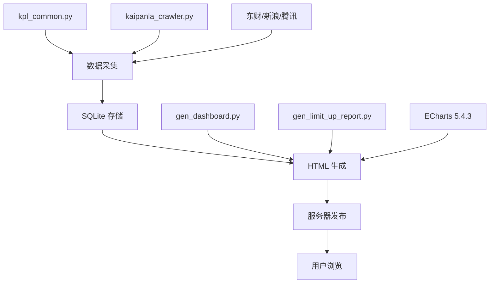

# A股题材主线深度透视看板 (kpl-dashboard)

基于开盘啦（KPL）、东方财富、新浪等行情 API 的 A 股板块强度与情绪分析系统，提供多维度可视化看板、涨停深度分析和自动数据维护功能。

---

## 功能概览

### 📊 主线题材分析
| 功能 | 描述 |
|------|------|
| **板块强度分析** | 前 20 名板块 N 天累计强度走势 + 沪深300 叠加，支持 N=1/3/5 天切换、HS300 缩放、鼠标跟随排名 |
| **板块强度分布** | 正/负值强度饼图 + 时间拖动条，直观展示强弱分布变化 |
| **百日新高分析** | 全市场百日新高数量（折线）+ 当日新增（柱状）+ 沪深300 叠加 |
| **板块百日新高** | 前 20 板块新高数量走势，可勾选扩展至前 20 |
| **百日新高分布** | 前 10 名板块 + 其他，时间拖动条 |

### 📈 情绪分析
| 功能 | 描述 |
|------|------|
| **上涨与下跌** | 涨跌停双 Y 轴折线图 + 涨跌家数 + 沪深300 叠加 |
| **涨停溢价与炸板率** | 溢价率和炸板率时序图 + 沪深300 |
| **连板高度与一字板** | 连板数（折线）+ 一字板数（折线）+ 连板高度（柱状）+ 沪深300 叠加 |

### 📋 涨停个股分析
| 功能 | 描述 |
|------|------|
| **板块-个股映射** | 精选板块下拉选择 → 细分板块（涨停原因）标签 → 个股映射表格 |
| **板块涨停分布** | 各板块涨停个股数量饼图 + 时间拖动条 |

### 📄 涨停深度报告
- 过去 10 个交易日涨停个股全维度分析
- 板块要闻（强度前 3 + 增长前 3，各 15 条）
- 涨停原因排行 / 板块涨停统计 / 高频涨停个股
- 每日涨停详情（连板梯队 + 涨停股表 + 炸板股 + 大幅回撤）

### 🤖 数据自动维护
- **盘中自动刷新**：交易日 9:30-15:00 按设定间隔刷新
- **自动收盘下载**：每个交易日 15:15 自动执行
- **历史补全**：蚂蚁搬家式单线程 + 随机延迟，安全补充历史数据

---

## 数据来源

| 数据源 | 用途 | 接口类型 |
|--------|------|---------|
| **开盘啦 (KPL) API** | 板块强度、百日新高、涨停梯队、情绪数据等核心数据 | HTTP API |
| **东方财富 API** | 沪深 300 日 K 线（主源） | HTTP API |
| **新浪财经 API** | 沪深 300 K 线（备源）+ 实时行情 | HTTP API |
| **腾讯财经 API** | 沪深 300 K 线（备源） | HTTP API |

---

## 架构设计

```
┌─────────────────────────────────────────────────────────────────────┐
│                         HTML 看板 (ECharts 5.4.3)                    │
│  10个ECharts图表 + 导航菜单 + 数据管理面板 + 移动端适配               │
│  src/gen_dashboard.py  ──   src/gen_limit_up_report.py             │
└──────────────────────────────────────────────────────────────────────┘
                               ▲
                               │ 读取 SQLite
┌──────────────────────────────────────────────────────────────────────┐
│                     Flask Web 服务器 (server.py)                      │
│  RESTful API (6个端点) + 自动任务调度（盘中/收盘/历史补全）            │
│  GET  /  → HTML看板                                                  │
│  POST /api/download_latest → 一键收盘下载                            │
│  POST /api/intraday_refresh → 盘中刷新                              │
│  POST /api/intraday_toggle → 自动盘中开关                            │
│  POST /api/auto_close_toggle → 自动收盘开关                          │
└──────────────────────────────────────────────────────────────────────┘
                               ▲
                               │ 读写
┌──────────────────────────────────────────────────────────────────────┐
│                      SQLite 数据库 (kpl_dashboard.db)                 │
│  8张表：板块强度 / 百日新高 / 沪深300 / 市场情绪 / 板块情绪            │
│         板块-个股映射 / 连板梯队 / 操作日志                           │
└──────────────────────────────────────────────────────────────────────┘
                               ▲
                               │ 批量写入
┌──────────────────────────────────────────────────────────────────────┐
│                     数据采集层 (kpl_common.py)                        │
│  ~30个函数：批量下载 + 多源回退 + 多线程/单线程模式                   │
└──────────────────────────────────────────────────────────────────────┘
                               ▲
                               │ HTTP请求
┌──────────────────────────────────────────────────────────────────────┐
│                    KPL API 爬虫 (kaipanla_crawler.py)                 │
│  ~50个API端点：板块/指数/涨停/情绪/资金/龙虎榜/成分股...              │
│  实时 + 历史双模式, 含集合竞价、分时、板块要闻等扩展API               │
└──────────────────────────────────────────────────────────────────────┘
```

## 技术栈

| 组件 | 技术选型 |
|------|---------|
| 语言 | Python 3.8+ |
| Web 框架 | Flask + 线程调度 |
| 数据库 | SQLite |
| 可视化 | ECharts 5.4.3（支持离线内嵌 / CDN 两种模式） |
| HTTP 请求 | requests（多源回退：东财 → 新浪 → 腾讯） |
| 并发下载 | concurrent.futures（多线程 3-8 worker） |
| 前端 | 原生 ES6 + CSS3（无框架依赖） |
| 离线模式 | ECharts 内嵌 + 离线检测，单文件可交互 |

---

## 快速开始

### 1. 克隆仓库

```bash
git clone https://github.com/<YOUR_GITHUB_USERNAME>/kpl-dashboard.git
cd kpl-dashboard
```

### 2. 安装依赖

```bash
pip install flask requests
```

### 3. 下载 ECharts 离线库（可选，用于离线 HTML）

```bash
python -c "import urllib.request; urllib.request.urlretrieve('https://cdn.jsdelivr.net/npm/echarts@5.4.3/dist/echarts.min.js', 'lib/echarts.min.js')"
```

### 4. 启动服务器

```bash
python server.py
```

打开浏览器访问 `http://localhost:5000`

### 5. 首次全量数据采集

点击页面上方 **「一键下载最新收盘数据」**，或手动运行：

```bash
python scripts/download_today.py
```

---

## 项目结构

```
kpl-dashboard/
├── server.py                        # Flask Web 服务器 + RESTful API
├── lib/
│   ├── kaipanla_crawler.py          # KPL API 爬虫核心（~50个接口）
│   └── echarts.min.js               # ECharts 5.4.3（git忽略，首次需下载）
├── src/
│   ├── gen_dashboard.py             # A股题材主线深度透视看板 HTML 生成器
│   └── gen_limit_up_report.py       # 涨停个股深度分析报告 HTML 生成器
├── scripts/
│   ├── kpl_common.py                # 共享工具模块（28个函数）
│   ├── kpl_data_collector.py        # 数据采集器 v7（首次全量采集）
│   ├── download_today.py            # 盘后数据下载
│   ├── download_history.py          # 历史数据下载
│   ├── backfill_history.py          # 蚂蚁搬家式历史补全
│   ├── daily_maintenance.py         # 每日定时维护入口
│   ├── verify_all_apis.py           # KPL API 全接口验证
│   └── gen_api_report.py            # API 验证报告生成器
├── data/
│   └── kpl_dashboard.db             # SQLite 数据库（git忽略，运行时生成）
├── output/                          # HTML 输出（git忽略，运行时生成）
├── docs/                            # 文档资料
└── .gitignore
```

---

## 数据库表结构

| 表名 | 记录数(参考) | 用途 |
|------|------------|------|
| `sector_list` | 258 | 板块代码/名称映射 |
| `sector_strength` | 16,898 | 板块强度日数据（66 天） |
| `new_high` | 362 | 全市场百日新高 |
| `sector_new_high` | 91,246 | 板块百日新高（362 天） |
| `hs300_kline` | 50+ | 沪深 300 日 K 线 |
| `market_sentiment` | 250+ | 涨跌停/溢价/炸板率 |
| `sector_sentiment` | — | 板块涨跌停数量 |
| `sector_stock_mapping` | — | 板块-涨停股映射 |
| `ladder_data` | 9+ | 连板梯队数据 |

---

## 服务器 API 文档

| 端点 | 方法 | 参数 | 说明 |
|------|------|------|------|
| `/` | GET | — | 返回最新看板 HTML |
| `/api/stats` | GET | — | 数据库统计（各表记录数/时间范围） |
| `/api/trading_days` | GET | `start`, `end` | 交易日列表 |
| `/api/download_latest` | POST | — | 一键下载最新收盘数据 |
| `/api/download_range` | POST | `start`, `end` | 指定日期区间数据下载 |
| `/api/intraday_refresh` | POST | — | 立即刷新盘中数据 |
| `/api/intraday_toggle` | POST | `enabled`, `interval` | 开启/关闭盘中自动刷新 |
| `/api/auto_close_toggle` | POST | `enabled` | 开启/关闭自动收盘下载 |
| `/api/download_status` | GET | — | 当前下载任务状态 |

---

## 离线静态 HTML

生成器会自动内嵌 ECharts 库（当 `lib/echarts.min.js` 存在时），生成可离线交互的单文件 HTML，双击即可在浏览器中查看所有图表。

```bash
python src/gen_dashboard.py
# → output/A股题材主线深度透视看板_20260708-1847.html
```

---

## KPL API Token（可选）

部分受限接口（板块成分股、龙虎榜、个股 F10 等）需要登录 Token。当前无 Token 状态下，系统使用替代 API 满足主要功能。如需获取 Token：

1. 在手机端安装抓包工具（HttpCanary / Charles）
2. 打开 KPL app 登录
3. 从登录请求中提取 `Token` 和 `UserID` 参数
4. 替换 `lib/kaipanla_crawler.py` 中的硬编码值

---

## 数据更新策略

| 策略 | 触发方式 | 更新内容 |
|------|---------|---------|
| 一键下载 | 手动点击 / `download_today.py` | 完整 6 步流程（见上文） |
| 盘中刷新 | 自动定时 / 手动触发 | 沪深300实时 + 百日新高 + 板块强度（实时端点）+ 市场情绪 + 个股映射 |
| 自动收盘 | 15:15 定时 | 同「一键下载」完整流程 |
| 历史补全 | `backfill_history.py` | 单线程+随机延迟，每天补 2 天历史强度数据 |
| 同花顺热榜 | 生成报告时触发 | 热点板块排行 |

---

## 开发与维护

### 构建流程



### 依赖

```bash
pip install flask requests
```

### 环境要求

- Python 3.8+
- Windows / macOS / Linux
- 网络连接（用于行情 API 请求）

---

## License

MIT


---

## ⚠️ 隐私说明

本仓库为公开版，已做以下隐私处理：
- 本地文件路径已替换为占位符
- 个人信息已脱敏
- 开发记忆(dev-memory)已移除
- 数据库文件(db)不纳入版本控制

完整版(含开发记忆)在私密仓库中维护。

## 致谢

本项目使用 [TRAE IDE](https://www.trae.cn/) AI 辅助开发，参加 TRAE AI 创造力大赛。
