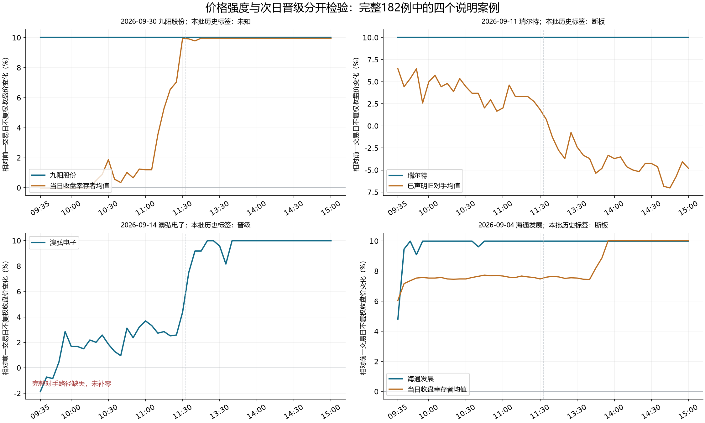

# 审美价量比较与反例

本批把价格修复、相对价格领先和盘口承接分开，新增可调用的 `relay_aesthetic_context.py`，并接入 `stock_short_term_context.py` 完整候选事实卡。已有182例中，采样价格跌离涨停后恢复的29例，有20例包含次日标签，其中6例晋级、14例断板；相对当日收盘同板位幸存者在全部采样点领先的30例，有25例包含标签，其中14例晋级、11例断板。价格表现可以支持观察问题，尚不足以单独确认核心、晋级或可成交。

实际形成时间：2026-10-13T04:08:34.529423+00:00（北京时间2026年10月13日午间）。复用已保存行情、官方日历与来源包，不新采行情或论坛。本批是已知历史资料诊断，不是当日实时判断、独立盲测或新数值模型验收。

## 本批直接补强了什么

逐股事实卡增加 `aesthetic_price_comparison`。它只接收角色引擎已核对来源、时间和字段的事实投影，输出观察状态、比较范围、反解释问题及证据缺口，不生成晋级判断、买点、审美总分或校准概率。

- 一字领先：标明尚未经历真实打开后的压力检验。低换手代理与真实日线一字分开。
- 跌离后恢复：只认定采样价格离板后恢复，不把五分钟柱推成逐笔回封、吸收抛压或买单稳定。
- 柱内价格压力：采样收盘均在涨停，但区间低点曾回落，必须保留柱内先后未知。
- 完整采样未观察到回落：不改写为逐笔从未开板；缺采样网格时保留未知。
- 相对强度：当日收盘幸存者与此前声明对手分别比较，完整均值领先也不等于战胜每个对手或主动卡位。微小涨幅差可能来自涨停价取整。

原四项短线审阅、支持与反证、取消条件和事前预期契约继续使用。描述不能替作者确认交易身份，不能成为模型负向理由的自动补充，也不将未核查或缺失当成看空证据。

## 完整分母与反例

原历史池9245个候选身份全部保留。本批复用其中182个具有已保存采样来源的案例、209条价格路径；182例有133个已知次日标签、49个未知。样本来源不是随机全市场抽样，当前幸存者比较尤其存在收盘入池选择，以下次数不能直接作为实时成功概率。

| 预先固定的观察子集 | 案例数 | 已知标签 | 次日晋级 | 次日断板 | 标签未知 |
| --- | ---: | ---: | ---: | ---: | ---: |
| 真实日线一字 | 39 | 26 | 15 | 11 | 13 |
| 采样跌离后恢复 | 29 | 20 | 6 | 14 | 9 |
| 柱内回落但采样收盘未离板 | 55 | 41 | 15 | 26 | 14 |
| 相对当日收盘幸存者全部采样点领先 | 30 | 25 | 14 | 11 | 5 |
| 相对完整原声明对手全部采样点领先 | 1 | 1 | 0 | 1 | 0 |

这些子集互相重叠，不能相加。原声明对手比较只有1例完整，无法据此认证或否定一种战法。完整名单、正例、反例及未知都在 `historical_descriptor_contradictions_FINAL.json` 和 `完整182例审美事实与已知结果.csv`，没有挑掉失败或未知。

182例价格路径分型为：34例观察到全采样OHLC一字、29例采样跌离后恢复、55例柱内压力、58例完整采样未见触板后回落、6例网格不完整未知。全采样OHLC一字34例与真实日线一字39例采用不同证据口径，不能互相替代。此归档收盘样本中没有“跌离且采样未恢复”分类，不代表市场不存在此情形。

## 九阳与三个说明案例

以下四例在完整诊断之后选取，用于说明概念，不是四只新测试股票。两例固定关注九阳与完整旧对手案例，另两例按固定字典顺序选取恢复路径中的晋级与断板案例。四例本批历史标签范围与其他正式结算记录分别保留。

1. **2026-09-30 九阳股份（002242）**：五分钟柱内曾回落，采样收盘未离板，触板后区间低点回撤为-2.64%。相对当日收盘同板位幸存者的收盘涨幅差约0.0713个百分点；盘中有较大领先，但不能仅凭末端微小差值认证主动卡位，完整原对手比较仍未知。供应商首封与末封时间差24.5分钟不是实际累计开板时长。本历史包未提供其对应目标标签，因此保留未知；这不撤回项目其他正式结算中的九阳晋级事实，不把其他来源的标签无绑定补入本批分母。
2. **2026-09-11 瑞尔特（002790）**：相对原声明对手云煤能源（600792）的48个采样点均领先，最小领先约3.5778个百分点、收盘领先约14.8532个百分点，已知次日却断板。它证明当日价格优势与次日晋级应分别检验，不能推导主动卡位或核心身份。
3. **2026-09-14 澳弘电子（605058）**：采样触板后跌离、后续采样恢复，已知次日晋级；完整对手价格比较缺失，不能用零序列替代。
4. **2026-09-04 海通发展（603162）**：也存在采样跌离后恢复，已知次日断板。与澳弘一起提示：恢复图形相似，不足以单独决定晋级，仍需市场阶段、主题地位、原对手及预期检验。

图中横轴等距排列48个真实观察点，并以真实时间标注，中午分界不表示连续交易时长。纵轴为相对官方前一交易日不复权收盘价的价格变化，不是策略收益。橙线只在完整比较时显示，均值不代表逐对胜出。首次图与修正后的标签/图例版本均保留，数值曲线未改变。

## 在实际判断中怎样使用

先写股票为何被资金关注的可证实联系，再写价格路径。市场主线变化、个股叙事变化和自身相对价格优势分别填写，不能从同板位活口直接推出“脱离题材”。旧叙事、仅点名板数或业务存在也不足以认证当前主导交易叙事。

一只股票经历分歧后，应顺序核对：实际观察到哪种压力、价格是否恢复、此前完整对手怎样表现、共同晋级/共同失败/相互卡位分别有哪些证据、恢复与事前正常路径相比是否超预期，以及该观察是否支持可成交。没有盘口或成交记录时，承接与进场资格继续保持未核。

下一未冻结日期将这些事实作为作者审阅问题，与已有事前normal/stronger/weaker预期共同使用；到实际窗口只追加对应来源和时间的观察，不能事后修改正常路径。这批描述尚未取得前向预测增益、主动卡位身份标签或盘口承接标签，因此不能启用新的晋级分数。

## 实际接入与核验

实际重建10月12日完整18只事实卡，全部新增了该字段。18只均缺少合格分时价格路径，因此状态均为 `UNKNOWN_NO_QUALIFIED_INTRADAY_PRICE_PATH`；没有拿9月历史分时替代10月12日。卡片只作为本次诊断附页，不是新登记或原作者审阅。

119项相关单元核验通过；实际完整18只重建一致、展示值篡改拒绝、删候选拒绝、182例初版/最终数值与分类一致、9245原身份保留、133/49标签分母核对、来源绑定及8个原件保护哈希均通过。检查记录为 `actual_integration_verification.json`。这些验证说明代码和口径可复核，不能算预测准确率改善。

初版描述、最终描述、对照和图示均留档。最终描述只增加涨停价取整的解释与审阅问题；本批无权重拟合、无阈值搜索、无模型切换、无交易收益声称。本批新增成熟前向样本0；本层未生成预测，因此Accuracy、Recall、Precision、F1和Brier均没有新值。原登记、原分数及原18只预测哈希保持。

预算从2026-10-13T03:48:06Z计30分钟，前夜初步检查到用户恢复之间的等待不计工作预算。实际结束时间及耗时见 `completion_receipt.json`。本批结束条件为事实模块、完整反例检查与实际接入，整体短线思维目标尚未完成验收。

**唯一下一步**：原10月13日目标到有效收盘后，先按原适配器完整结算原18只并定位主要错误；这批价格描述用于下一未冻结日期的独立事实审阅，不倒填本日预测。

来源入口：`all182_aesthetic_price_facts_FINAL.json`、`historical_descriptor_contradictions_FINAL.json`、`current18_WITH_AESTHETIC_CONTEXT.json`、`plot_source_receipt_FINAL.json` 与其各自绑定的原来源。使用连板接力、市场数据核验及回测完整性技能，用户原分数/来源/完整分母约束优先；本批不采用技能示例中的另加100分或未校准概率。
