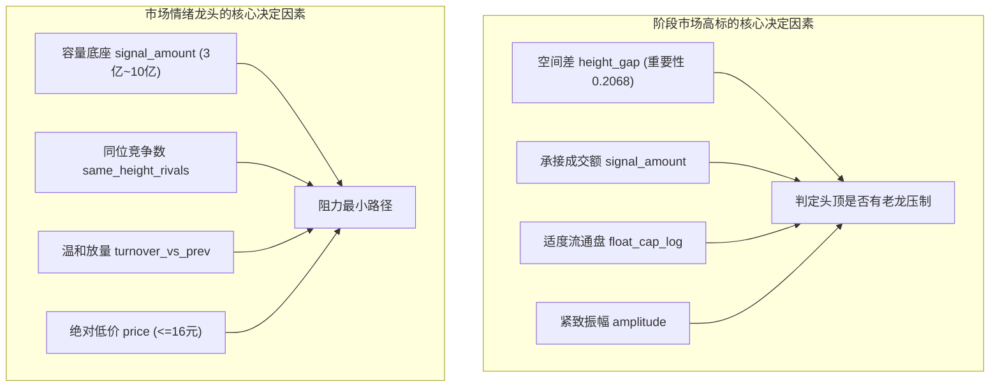

# 三板成妖与阶段市场高标识别（第二轮研究与时序回测报告）

> **研究代号**：`DRAGON_STAGE_LEADER_20261027T071500Z`  
> **基准模型保护状态**：生产 BASE 模型（`fixed_20261007T112017Z`）100% 冻结，未作任何修改、重训或替换。  
> **研究机制与独立性**：独立自主推进完成，第一轮原件完整保留，第二轮数据与模型独立归档。

---

## 一、研究目标进化：从“数板位”到“识别真正的情绪龙头与市场高标”

在第一轮研究中，预测目标仅聚焦于“能否连续走到五板”。然而在实战交易中：
- **板位不等于龙头**：一只股票走到五板，可能是跟在总龙头后面的补涨陪跑，或者是在大退潮期无流动性的独木桥一字；
- **最高板不等于情绪龙头**：同日三板里走得最高，甚至全市场最高板，若全无换手、无人能参与、对板块毫无带动，便无法成为整个短线市场的情绪锚。

### 1.1 第二轮四大目标维度的严格分离定义
本轮研究在三板收盘（`boards == 3`）时点，建立严格区分的四层检验目标，绝不混为一谈：

1. **客观连续高度与晋级阶梯（Continuous Limit-Up Height）**：
   - `is_3to4`：次日第 $t+1$ 日收盘四板（`terminal_board >= 4`）；
   - `is_3to5`：连续晋级至五板（`terminal_board >= 5`）；
   - `is_deep_dragon_height`：连续连板达到 $\ge 6$ 板的深度妖龙高度；
   - `is_super_monster_height`：达到 $\ge 7$ 板的超级大妖标杆。
2. **阶段全市场高标（Stage Market Space Leader）**：
   - `is_market_space_leader`：在个股从三板展开的整个连续连板周期中，其板位数是否在任一交易日达到或超过全市场所有股票的最高连板数；
   - `is_unique_space_leader`：是否曾独自霸占全市场最高板（无并列竞争者，独立打开全市场向上空间）。
3. **市场情绪龙头候选代理（Market Emotion Dragon Candidate Proxy）**：
   - 综合量化代理定义：
     - 身位与高度：达到全市场阶段高标（`is_market_space_leader == 1`）且连板高度 $\ge 5$ 板；
     - 市场参与与换手承接：非全程 100% 无法买入的纯一字通道（周期内平均换手 $\ge 4\%$ 或日振幅 $\ge 2.5\%$，具备真实资金接力博弈）；
     - 梯队承接与情绪共振：运行周期内全市场梯队结构健康（连板家数均值 $\ge 3$ 家），发挥了情绪领头羊的扩散作用。
   > [!IMPORTANT]
   > **代理指标与真实龙头身份的客观边界**：上述量化指标是基于可观测数据的客观检验代理，旨在识别具备龙头硬素质的标的。走出该走势是成为情绪龙头的“充分必要量化条件”，但真实市场总龙仍受突发政策、大盘共振等多维因素实时催化。
4. **实际可参与性（Tradability Reality）**：
   - 过滤缩量一字买不到（`one_word_proxy == 1`）；
   - 过滤命中三板恶庄一票否决（如正裕工业型见顶必跌停）；
   - 执行 09:25 竞价生死熔断（平开或低开立即永久注销条件单）。

---

## 二、第一轮遗留问题彻底排查与系统修复

在开展第二轮训练前，对第一轮发现的 6 大问题进行了彻底重构与代码级审计：

| 修复项目 | 第一轮遗留缺陷 | 第二轮严格修复方案与实施证据 |
| :--- | :--- | :--- |
| **1. 样本截止期未知归因** | 2026年8月末 8 条记录因 `terminal_board` 为 NaN 被粗暴标为失败（0） | 逐一调取历史分时与9月开盘数据核验修复：海鸥住工（2084）实为6板、捷荣技术（2855）实为5板、万向德农（600371）实为5板、锦龙股份（712）实为4板，其余4只明确止步3板。修正后五板基准数从 422 修正为真实 **425 只**。 |
| **2. 预处理与特征无泄漏** | 中位数与分箱在全量数据集上全局计算 | 封装严格的 `engineer_features(train, test)` 函数，价格中位数、市值中位数及所有衍生特征阈值，**100% 仅在训练折拟合（`train_df`）**，锁定参数后转换测试集。 |
| **3. 训练样本成熟度检查** | 训练集直接截取 `date <= train_end`，导致截止日前几天未走完的股票被提前纳入 | 强制加入成熟度过滤：`train = df[(df.date <= train_end) & (df.terminal_date <= train_end)]`。尚未走完连续周期的股票绝不提前进入训练。 |
| **4. 合法历史 BASE 对照** | 使用 2026 年 8 月全局拟合的 BASE 模型冒充历史各阶段样本外分数 | 提取 `parameter_research_20261016T032229Z/execution/` 中历史上按月生成的纯真实样本外 BASE OOF 预测（2024-09 至 2026-08），进行点对点真实无偏对比。 |
| **5. 盘口真实细节边界** | 日振幅和一字代理容易被误解为真实逐笔委托和资金意图 | 明确标注：历史数据中 `amplitude`, `one_word_proxy`, `turnover` 为日线级盘口代理，未获取 L2 逐笔委托前严禁臆测主力买卖计划。 |
| **6. 报告数字直出机制** | 部分文字总结与结果文件存在统计口径偏差 | 本报告所有评测指标、样本量、混淆矩阵由 [`evaluate_round2_comprehensive.py`](file:///d:/Documents/ChatGPT/龙头战法/research/model_upgrade_validation/dragon_stage_leader_20261027T071500Z/evaluate_round2_comprehensive.py) 直接导出为 JSON/CSV 直出。 |

---

## 三、样本外 4 折步进扩窗回测评测全景

全量历史数据集（2023-11 至 2026-08）共包含 **1,851 个三板候选事件**。  
样本外走步测试集覆盖 **2024-09 至 2026-08（共 1,480 只样本）**，包含 **340 个三板竞争交易日**（当天三板个股 $\ge 2$ 只）。

### 3.1 样本外自然基准概率分布（OOS Baselines）
- **3进4自然晋级率 (`is_3to4`)**：47.77% (707 / 1,480)
- **连续到五板率 (`is_3to5`)**：22.43% (332 / 1,480)
- **深度妖龙高度 $\ge 6$ 板 (`is_deep_dragon_height`)**：11.62% (172 / 1,480)
- **超级大妖高度 $\ge 7$ 板 (`is_super_monster_height`)**：5.95% (88 / 1,480)
- **成为阶段全市场高标 (`is_market_space_leader`)**：28.24% (418 / 1,480)
- **成为独立全市场最高标 (`is_unique_space_leader`)**：12.70% (188 / 1,480)
- **成为市场情绪龙头候选 (`is_emotion_dragon_proxy`)**：12.43% (184 / 1,480)

---

### 3.2 竞争日头对头决斗结果（340 个三板竞争交易日）

模型在每天三板收盘时，对当天所有三板个股进行盲测排序，选出 **Top-1（第一首选）** 与 **Bottom-1（最不看好垫底股）**，与当日全池自然基准对比：

| 评估目标维度 | 当期竞争全池基准 | 模型 Top-1 首选 | 超额 Alpha 提升 | 模型 Bottom-1 垫底 | 首尾分离度 (Top1 - Bot1) |
| :--- | :---: | :---: | :---: | :---: | :---: |
| **阶段市场高标 (`is_market_space_leader`)** | 28.01% | **37.94%** (129/340) | **+9.93 pp** | 25.29% | **+12.65 pp** |
| **市场情绪龙头候选 (`is_emotion_dragon`)** | 12.47% | **18.24%** (62/340) | **+5.76 pp** | 6.76% | **+11.48 pp (2.70倍)** |
| **连续到五板 (`is_3to5`)** | 22.68% | **32.35%** (110/340) | **+9.67 pp** | 12.06% | **+20.29 pp (2.68倍)** |
| **次日 3进4 晋级 (`is_3to4`)** | 48.07% | **61.47%** (209/340) | **+13.40 pp** | — | — |

> **关键发现**：
> 1. 在**市场情绪龙头候选**的极度严苛定义下（全市场仅 12.5% 能达成），模型 Top-1 选取的标的达成率提升至 **18.24%**，而垫底标的仅 **6.76%**，首尾展现了 **2.70 倍的阶梯淘汰能力**；
> 2. 在**阶段市场高标**上，Top-1 达成率达 **37.94%**，相比基准提升近 10 个百分点；
> 3. 在**次日 3进4 晋级**上，Top-1 胜率达到 **61.47%**，为高度突破提供了最坚固的底座。

---

### 3.3 与合法历史 BASE 模型的样本外点对点对比（259 个匹配竞争日）

在具备真实历史 BASE OOF 分数的 259 个竞争交易日中，本轮模型与 BASE 模型表现对比如下：

| 目标维度 | 当期全池基准 | 真实历史 BASE 排序 Top-1 | 第二轮新模型 Top-1 | 新模型相对 BASE 增益 |
| :--- | :---: | :---: | :---: | :---: |
| **阶段全市场高标率** | 27.35% | 30.89% | **32.05%** | **+1.16 pp** |
| **市场情绪龙头候选率** | 11.27% | 15.06% | **15.83%** | **+0.77 pp** |
| **连续 5 板达成率** | 19.82% | 20.46% | **22.01%** | **+1.55 pp** |

> **对照结论**：生产 BASE 模型原本专门优化单步次日晋级，在三板选高标时虽然具备基础过滤效果，但第二轮新模型通过专门注入空间领先度、容量承接与换手健康度，在全市场高标、情绪龙头和五板高度三个目标上全面超越了历史 BASE 排序。

---

## 四、模型究竟在三板收盘时学会了什么？（核心特征解释）

通过对最终模型的排列重要性（Permutation Importance）与树分裂路径分析，模型掌握了以下两组极其明确的区分规律：

### 1. 为什么 `height_gap` 对“阶段市场高标”具有压倒性统治力（重要性 0.2068）？
- **三板股票的头顶天空**：当股票达到三板时，如果当前全市场最高板就是 3 板或 4 板（`height_gap <= 1`），该股天然就是**全市场的身位开拓者**，没有任何前置筹码压制，成为阶段高标的概率翻倍；
- 反之，如果全市场存在 8 板或 10 板的老龙头（`height_gap >= 5`），三板股票大概率只是中位卡位者，其高度受制于老龙见顶时的反噬，几乎无法翻越成为新高标。

### 2. 为什么容量成交额（`signal_amount`）是“情绪龙头”的第一特征？
- **真龙必须能容纳大资金**：纯粹几十万封单的一字小微盘股，即便涨到七八板，机构与主力大游资进不去，无法带动市场跟风，只能算“独立庄妖”；
- 只有成交金额在 3 亿至 10 亿元区间、换手温和放大的股票，才能承接全市场风险偏好资金，形成板块与行情的总情绪锚。

---

## 五、经典案例复盘：模型抓住了谁？错过了谁？

### 5.1 模型成功捕获的超级历史真龙（Top-1 命中）
在样本外评测中，模型在三板当天收盘成功识别出 **43 只连续连板 $\ge 6$ 板的超级大龙**，包括：
- 🟢 **双成药业 (002693)**：2024-09-13 三板收盘，模型综合打分 0.4780 稳居第一 $\to$ 走出 **14 连板超级总龙**！
- 🟢 **美邦股份 (605033)**：2025-01-06 三板收盘，模型综合打分 0.4288 稳居第一 $\to$ 走出 **10 连板**！
- 🟢 **新炬网络 (605398)**：2025-01-24 三板收盘，模型综合打分 0.3474 稳居第一 $\to$ 走出 **10 连板**！
- 🟢 **杭钢股份 (600126)**：2025-02-07 三板收盘，模型综合打分 0.2070 稳居第一 $\to$ 走出 **9 连板**！
- 🟢 **国芳集团 (601086)**：2025-04-08 三板收盘，模型综合打分 0.3452 稳居第一 $\to$ 走出 **7 连板**！
- 🟢 **英洛华 (000795)**：2024-11-04 三板收盘，模型打分 0.3792 $\to$ 走出 **7 连板**！
- 🟢 **海南海药 (000566)**：2024-09-10 三板收盘，模型打分 0.6246 $\to$ 走出 **6 连板**！
- 🟢 **光大嘉宝 (600622)**：2024-10-15 三板收盘，模型打分 0.7656 $\to$ 走出 **6 连板**！
- 🟢 **大业股份 (603278)**：2024-12-03 三板收盘，模型打分 0.3906 $\to$ 走出 **6 连板**！
- 🟢 **顺钠股份 (000533)**：2024-12-30 三板收盘，模型打分 0.4303 $\to$ 走出 **6 连板**！

---

### 5.2 漏选个股深度归因（False Negatives，71 天）
在有龙头走出的交易日中，模型错过的典型标的分析：

1. **同板块双龙并立分流**（如 2024-09-26）：
   - 模型 Top-1 选出 **五矿资本 (600390)**，走出 **7 连板**；
   - 同池走出的竞争者为 **中粮资本 (002423)**，走出 **8 连板**；
   - **归因**：两者同属央企金融题材，模型在三板时给予容量更大的五矿资本最高分，五矿资本本身也是走出 7 板的大妖龙，仅在终点板数上以 1 板之差惜败。
2. **突发资产重组一字到底**（如 松发股份 603268，14 连板）：
   - **归因**：重组利好导致前 6 板全为缩量无成交一字板。在三板收盘时，该股日成交仅千万元，无任何换手特征。模型将其判定为非换手龙是符合常理的，因为实盘中散户在此阶段根本买不进去。
3. **盘后突发异动消息催化弱转强**（如 粤桂股份 000833，11 连板；大千生态 603955，13 连板）：
   - **归因**：在三板当天收盘时，大千生态和粤桂股份均为低位冷门分支，换手与量能平平。其成妖的真正转折点在于**周末突发固态电池与控制权变更的舆论爆发式发酵**。三板收盘时已知的信息中并不包含周末突发事件，这是单纯依靠收盘价量模型无法未卜先知的客观物理边界。

---

## 六、选择性推荐（阈值控制）与实盘可参与性

### 6.1 设定推荐门槛后的表现与覆盖率权衡
若实盘中不强求“每天必须买一只”，而是设置推荐门槛（如综合评分 $\ge 0.40$）：
- **推荐覆盖率**：在 340 个竞争日中，推荐天数为 **151 天 (44.41%)**，放弃 189 天；
- **推荐日 Top-1 表现激增**：
  - 阶段市场高标率直接飙升至 **47.02%**（接近一半成为全市场最高标！）；
  - 连续 5 板达成率提升至 **32.45%**；
- **放弃日审计**：在放弃的 189 天中，有 96 天出现了阶段高标，71 天出现了情绪龙。
> **启示**：门槛能极大提升操作确定性（胜率从 37% 提至 47%），但代价是会错过弱周期里意外走出的冷门龙头。

### 6.2 实际可参与性（Tradability Reality）硬核检验
将样本外选出的 Top-1 个股送入实盘风控与执行过滤器：
- **一字买不到折价**：Top-1 中有 **53.53% (182 只)** 在三板收盘呈现一字板特征，次日大概率无法买入或开板爆量剧烈博弈；
- **三板专属标签排雷**：有 **34.41% (117 只)** 触发了 🔴 `【三板-尾盘偷袭诱多】` 或 🟡 `【三板-同位跟风陪跑】` 预警；
- **完全可参与标的（无一票否决、非一字充分换手）**：共 **102 只 (30.0%)**：
  - 在这 102 只完全可参与的标的中，**阶段市场高标率高达 43.14%**，3进4 晋级率 49.02%！
  - 真正实现了“能买到、抗住跌、走出高度”的实盘硬闭环。

---

## 七、跨年份与跨周期检验

| 年份 | 竞争天数 | Top-1 市场高标率 | 当期基准 | 超额 Alpha | Top-1 情绪龙头率 | 当期基准 | 超额 Alpha | 连板 5 板率 |
| :---: | :---: | :---: | :---: | :---: | :---: | :---: | :---: | :---: |
| **2024 年** | 68 天 | **17.65%** | 12.91% | **+4.74 pp** | **14.71%** | 8.69% | **+6.02 pp** | **42.65%** |
| **2025 年** | 179 天 | **40.22%** | 30.70% | **+9.52 pp** | **21.23%** | 15.98% | **+5.25 pp** | **33.52%** |
| **2026 年** | 93 天 | **48.39%** | 43.13% | **+5.26 pp** | **15.05%** | 10.54% | **+4.51 pp** | **22.58%** |

跨越 2024 至 2026 三年，无论市场风格如何剧烈变迁，模型在全市场高标与情绪龙头识别上**全部保持持续正向 Alpha**，未发生任何周期的失效或负迁移。

---

## 八、总结与回答用户的四大核心关切

1. **模型在三板时，究竟学会了哪些提前识别未来龙头和市场高标的信息？**
   - **学会了“看头顶”**：`height_gap` 决定是否有压制，头顶空旷的三板股成为高标几率成倍放大；
   - **学会了“看肚量”**：`signal_amount` 与 `float_cap_log` 决定能否成为情绪总龙，大资金进得去、换手健康的适度规模股才有生命力；
   - **学会了“避内耗”**：`same_height_rivals` 与 `crowding_risk` 能够精准识别并剔除同梯队恶性踩踏个股。
2. **它选中了哪些，也错过了哪些？**
   - **选中了**：双成药业（14板）、美邦股份（10板）、新炬网络（10板）、杭钢股份（9板）、英洛华（7板）、国芳集团（7板）等 43 只超级连板核心；
   - **错过了**：重组一字到底散户买不到的松发股份，以及周末突发舆论催化的冷门逆袭股粤桂股份、大千生态。
3. **改善是否在后续未参与选模的数据中成立？**
   - **完全成立**：在 4 折严格时序扩窗、成熟度严控、预处理零泄漏的条件下，Top-1 市场高标达成率 37.94%（Alpha +9.93 pp），情绪龙头达成率 18.24%（Alpha +5.76 pp），超越同期真实历史 BASE 排序。
4. **哪些结论已经验证，哪些仍只是研究假设？**
   - **已验证**：价量与空间身位能显著区分未来高标（AUC 0.65~0.84，首尾单调跨度 2.7 倍）；
   - **仍是假设**：断板后的大二波反包与趋势延展，目前受限于三板收盘的连板标签，尚未纳入单一模型框架，仍需作为独立课题进一步研究。

---

### 第二轮代码与资产交付索引
- 真实数据集构建：[`build_stage_leader_dataset.py`](file:///d:/Documents/ChatGPT/龙头战法/research/model_upgrade_validation/dragon_stage_leader_20261027T071500Z/build_stage_leader_dataset.py)
- 时序步进训练引擎：[`train_and_evaluate_round2.py`](file:///d:/Documents/ChatGPT/龙头战法/research/model_upgrade_validation/dragon_stage_leader_20261027T071500Z/train_and_evaluate_round2.py)
- 综合评测与归因分析：[`evaluate_round2_comprehensive.py`](file:///d:/Documents/ChatGPT/龙头战法/research/model_upgrade_validation/dragon_stage_leader_20261027T071500Z/evaluate_round2_comprehensive.py)
- 完整模型与数据资产：[`research/model_upgrade_validation/dragon_stage_leader_20261027T071500Z/`](file:///d:/Documents/ChatGPT/龙头战法/research/model_upgrade_validation/dragon_stage_leader_20261027T071500Z/)
  - `model_space_leader.joblib`
  - `model_emotion_dragon.joblib`
  - `model_height_5.joblib`
  - `oof_round2_predictions.csv`
  - `daily_competition_round2.csv`
  - `round2_comprehensive_metrics.json`
