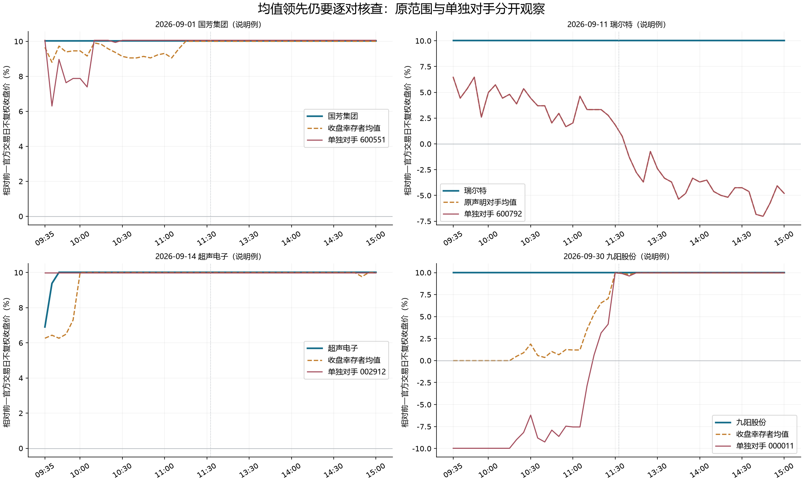

# 逐对竞争接入与均值反例

本批把“领先同伴平均值”进一步拆成逐一比较具体对手。新增 `relay_pairwise_comparison.py`，接入完整短线事实卡，并要求下一未冻结日期的作者审阅记录完整对手、价格领先过自己的成员，以及共同晋级、共同失败和分化三条路径。它不改原分数或晋级判断，也不把价格排名当核心身份。

形成时间：2026-10-13T05:16:12.015199+00:00。范围为已有182例、209条价格路径、原9245候选身份及当前18只附页。没有新增行情/论坛采集、数值训练或阈值搜索。

## 最有用的发现

182例中有122例能完整比较当日收盘同板位幸存者。30例在全部采样点领先该均值，其中16例却曾落后于某个具体对手。因此，比较均值的强度结论必须继续检查个别对手；即使对手大多走弱，也不能跳过其中仍然强的成员。

16例中14例有已知目标标签，6晋级、8断板，另2例未知。不能据此把它改成新的断板规则，也不能把结果当买入胜率。多数末端微小差值还可能来自涨停价取整，未认证主动卡位或资金流向。

这一步同时修复实际遗漏：缺价格路径时，已知且合格的同板位名单仍须保留，逐个标价格未知。没有价格资料不等于没有对手。当前收盘幸存者与原声明对手分栏；前一日落败者不会因为没进入当日收盘池就被当作已核查。

## 价格事实怎样输出

每个声明对手保留匹配采样次数、个股领先/持平/对手领先次数、价格涨幅差的最低/最高/末值及不完整原因。只有原参考交易日和实际采样时间都匹配，才允许完整逐对比较；缺路径、日期不符、网格不全保持未知，已观察的局部值不自动认证完整窗口。

精确比较使用原价格的有理数比值，没有另选容差或判断阈值。原浮点均值字段保留，两种均值符号在本批完整比较中一致。个股相对所有对手的价格变化名次只作观察，不推出核心地位、承接、买点或已实现收益。五分钟相同柱末不说明柱内逐笔先后。

新日期审阅字段 `pairwise_competition_assessment` 要求：

- current/prior分别写REVIEWED、PARTIAL_REVIEWED或有原因的UNKNOWN；完整、部分及缺资料不能混写。
- comparison_peer_codes与完整声明名单一致；incomplete_peer_codes与实际缺口一致；stronger_observed_peer_codes不能漏掉完整观察中领先过自己的对手。
- joint_promotion、joint_failure和divergence三条次日路径分别填写条件或未知原因，不能只剩二选一。
- 价格名次不认证核心，资金原因与进场资格继续独立核对。

这记录作者实际依据和反解释，不强迫未知方向转负，不给原模型加分。原已冻结18只只作本次真实时间附页，不能补造事前判断。字段示例 `pairwise_review_schema_TEMPLATE_ONLY.json` 是待作者审阅模板，不是新预测或AUTHOR_REVIEWED。

## 全部范围与结果

原9245身份保留；完整182例仍有133个已知目标标签、49个未知。当前完整逐对范围122例；原声明对手范围仅1例，其余缺口保留。代码与同伴均值的比较不替代完整题材或全市场分母。

以下是保存的有方向候选—对手记录。相同两只股票可能以两个方向出现，存在关联；价格比较缺口与标签缺口各自保留，不能把这些记录当独立交易样本。

| 比较范围 | 共同晋级 | 共同失败 | 目标标签分化 | 任一标签未知 | 有方向记录总数 |
| --- | ---: | ---: | ---: | ---: | ---: |
| 当日收盘同板位声明成员 | 80 | 246 | 312 | 292 | 930 |
| 原声明对手 | 10 | 34 | 50 | 453 | 547 |

原价格比较是否完整另存每行，以上共同晋级等只表示同目标标签，不证明相互带动、资金抢夺或主动卡位。标签在价格描述之后附加用于历史诊断，未参与定义比较状态。

## 四个说明案例

九阳9月30日和瑞尔特9月11日沿固定关注；另选择首个按字典排序的均值反例国芳集团9月1日，以及均值反例中观察到最大负向逐对差的超声电子9月14日。选例发生在完整诊断之后，只作图示，不是独立验证或筛选规则。

- 超声电子相对当日同板位收盘成员均值一直领先，但对002912的两个采样点落后，最低约-3.0925个百分点；后续修复与最初领先谁是两个不同问题。
- 国芳集团对均值持续领先，却在41个采样点略低于600551。其末端差很小，不能把取整产生的相对差写成主动强弱。
- 九阳在图示范围价格较强，但原完整对手范围仍不够；这不能单独确认脱离题材日期。本历史包的目标标签未知不撤回其他正式结算事实。
- 瑞尔特原对手仅云煤能源这一条完整比较，价格持续领先而已知次日断板，仍保留这个反例。

曲线为相对原官方前一交易日不复权收盘价的价格变化；48个采样点等距排列并标真实时间，不是连续时长或可成交收益。红线展示该声明范围中相对差最低的单独对手，其余对手仍在完整表。

## 实际接入与边界

已在原18只事实卡追加逐对竞争字段，原完整判断及评分保持。当前18只没有合格逐对价格路径，名单保留而价格状态未知；没有用9月行情填10月12日。必要相关82项检查通过；完整历史源重建、原身份与未知分母、当前18只精确重建、展示篡改及删候选拒绝见实际核验收据。这些不等于准确率提升。

首轮标签读取错误地访问逐行字段，133/49核对拒绝，错误记录保留；改为原顶层baseline_promotion按候选身份读取，原标签未改。作者审阅与缺路径名单修正后的代码进行了相关重建，初版及前像均保留，不重跑任何已结束数值挑战。共享leader_role_research.py在本批另有变化，实际哈希单列；本批没有改它，原引擎、模型、独立登记和原18只预测哈希核对保留。

本批新增真实成熟前向0、拟合0，本层没有新预测。Accuracy、Recall、Precision、F1、Brier没有新值；逐对解释是否改善晋级判断仍待同池事前检验，整体短线思维目标尚未验收。耗时、最终源核验和剩余要求见completion_receipt.json。

唯一下一步：有效10月13日收盘后按原适配器完整结算原18只，定位主要错误；本次逐对审阅仅用于下一未冻结日期，不回填本日预测。
