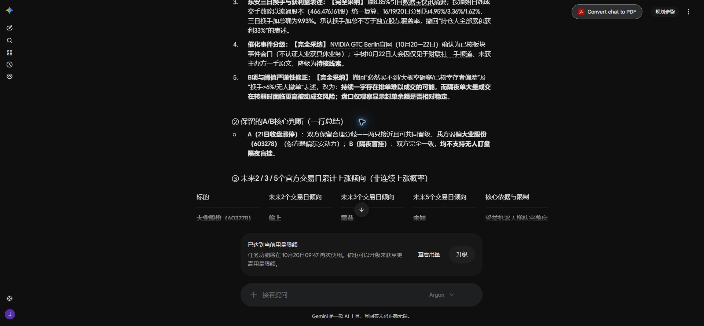

# 大业与东安：Chrome Gemini 4两轮辩论结论

整理时间：2026-10-20 15:40:09 UTC。两轮真实发送、两轮完整回复均已在Chrome现有Gemini对话中核对；模型选择器在发送前显示已选“4 Argon”。这确认网页所示模式，不独立认证底层模型服务标识。本次不是反重力Gemini，也没有用内部GPT子代理代替。

第二轮完整回复后，页面显示“已达到当前用量限额”。按用户“如果模型被限制就别跑了”的要求，已停止继续发送，无第三轮、不换模式、不升级、不重启已取消的训练。后续操作仅保存已收到的文本和截图。

## 最终结论

|问题|Codex最终立场|Gemini 4最终立场|是否形成共识|
|---|---|---|---|
|北京时间10月21日收盘涨停的成对相对排序|弱偏东安动力；低换手/走势平稳只是弱支持，增程及定点公告避免把其只当飞行汽车|弱偏大业股份；机器人盘面梯队及GTC事件窗口、19日较多价格交换是主要支持|仍有分歧；两只接近且可以共同晋级，没有共同第一|
|无人盯盘隔夜限价盲挂|不支持|不支持|一致；没有可验证的成交条件净收益优势|
|买后收益、真实成交、校准概率|未知|没有验证|不因辩论或相对排序声称已知|

我的修正：认可大业的板块梯队支持以及19日已发生较多交换，但这不能单独证明良性承接。保留此前弱偏东安的成对预测，不把“看好次日晋级”扩大为“东安隔夜排单收益更高”。原先二选一偏东安的条件性建议不能解读为今晚无需确认就下单。

Gemini的修正：由原先坚定大业、规避东安，收窄为两只接近、弱偏大业；接受东安增程业务和19日非全天一字事实，不再用“飞行汽车零收入”直接否定全部业务。双方没有通过争论确定谁会赢，概率均未验证。

## 两轮取得的实质纠正

1. 东安19日O/H/C=11.28、L=10.99，有价格交换；不能说连续两天完全无换手。按16/19/20原始成交手数与同一当前流通股本复算，日换手约4.95%/3.36%/1.62%，合计9.93%，纠正Gemini原8.85%。这只是统一分母估算与换手加总，不是独立股东覆盖比例，更不能说所有持仓人都有33%利润。
2. 东安三季度定点及增程客户有公司文本支持，是旧公开信息，不冒称20日新订单或已经确认的交付收入。飞行汽车无收入、销量下降与半年亏损仍是反证。
3. 大业晚间公告明确“亦未涉及市场热点概念”，不能仅称其为常规风险、对东安却使用一票否决。大业机器人归类是盘面交易解释，不能认证其取得新机器人业务。原公告及新转载原文一致。
4. 封单时点净余额变化不等于纯撤单/主动加单。本次实际原文核到：大业09:26约2.57亿元；午盘大业30088.44万元、东安41784.23万元；收盘大业22819.86万元、东安27464.21万元。午/收盘表与原归档一致，支持大业相对净余额更稳定这一描述；不认证逐笔队列或资金因果。东安早盘5.64亿元在本次未取得正确原始快照支持，Gemini所给4228307链接不能仅凭模型引用认证；故51.2%等完整早收比率不作为本次独立已核证据。另有东安1790.64万元异源报道冲突仍保留。
5. 已实际读两篇相关股吧原文。了因1991（10月20日15:17）同时列东安、大业为明日条件观察；孤渡者（10月20日16:04）同时看好两股4板，但隔夜更偏大业、东安等待换手。后者区分预测与执行的思路有参考价值，不能把作者计划当正确率认证、群体共识或资金因果。两篇正文均早于主要晚间风险披露，评论与楼主回复按各自时间分栏，不继承主帖时间。固定成交额阈值及“明日必晋级”措辞不采纳。
6. NVIDIA官方已核GTC Berlin于10月20—22日举行并包含物理AI/机器人内容，只能支持板块事件窗口；不认证大业订单。宇树22日大会未获主办方原文，Gemini已降为待核。不是因为没查到就判其为假。
7. Gemini接受撤回“一字就必买不到”“隔夜大量成交就大概率砸穿”“已核幸存者偏差”等过强表述。排队成交可能性、成交后的风险与预测事件分别保留，T+1风险不变；没有逐笔证据不说无人撤单。3.5—7亿、5—15亿、换手>6%等阈值无样本外验证，不作为新固定执行门。

## 事前路径与可证伪条件

以下日期来自已有官方交易日历：从21日为第1日计，2/3/5日分别到22/23/27日。均相对20日收盘的累计表现讨论，不是逐日上涨、连续涨停或经校准概率。

|股票与作者|至22日（2日）|至23日（3日）|至27日（5日）|
|---|---|---|---|
|大业—Codex原多日稿，继续保留|累计偏上，允许补量分歧|累计偏上，分歧加大|未知，不押逐日上涨|
|大业—Gemini第二轮原判断|偏上|震荡，未给正负累计方向|未知|
|东安—Codex原多日稿，继续保留|未知，21日后有补量需求|分歧震荡，累计正负未知|未知|
|东安—Gemini第二轮原判断|震荡，未给正负累计方向|震荡，未给正负累计方向|未知|

Gemini改选东安的观察组合：21日09:25—09:35观察窗口内，东安实际开盘交易守住自身均价、较大业更早稳定封板；大业仍受压于自身均价下且机器人中低位同步转弱。原回复还用了“梯队过半绿盘”，本报告将其保留为作者观察规则，不认证为经验证最优阈值。若东安仍一字，不能冒称已经历放量承接。

Codex撤销东安相对领先的条件：东安开板后持续失守开盘均价或12.41且不能修复、反复回封失败，而大业及机器人梯队维持更强。也可能两只共同转弱；不能强制选出可买者。任何21日盘中改选另记实际时点，不回写20日收盘预测。当前没有21日真实竞价/成交确认。

## 留档、来源与边界

原始发送稿：CODEX_round1_BEFORE_SEND.txt、CODEX_round2_BEFORE_SEND.txt；真实回复：GEMINI_round1_received_DOM.txt、GEMINI_round2_FINAL_received_DOM.txt；原Gemini成对判断：GEMINI_original_pair_DOM_BEFORE_SEND.txt；浏览器收据：browser_rounds_receipt.json。原始来源字节、真实请求/收件时钟及SHA在source_checks/manifest.json。

- [大业早盘快照](https://finance.eastmoney.com/a/202610203900809160.html)
- [证券时报午盘原表](https://www.stcn.com/article/detail/4227544.html)
- [证券时报收盘原表](https://www.stcn.com/article/detail/4227803.html)
- [大业风险公告原文转载](https://www.cfi.net.cn/p20261020001638.html)
- [东安定点公告](https://money.finance.sina.com.cn/corp/view/vCB_AllBulletinDetail.php?id=12637767&stockid=600178)
- [东安业绩说明会](https://money.finance.sina.com.cn/corp/view/vCB_AllBulletinDetail.php?id=12582371&stockid=600178)
- [了因1991原帖](https://m.tgb.cn/a/2w30IRKw3VY)
- [孤渡者原帖](https://www.tgb.cn/a/2w345GlTRHJ)
- [NVIDIA官方GTC Berlin](https://www.nvidia.com/en-eu/gtc/)

本次网页工具6个引用页打开失败后，进行了各1次有界公开HTTP取得并归档，未绕登录/付费/安全障碍。来源当下晚取得，不倒填20日更早原判断，更不倒填旧训练时点。新增论坛正文仅作为本次成对诊断资料，不假装原全46只预测前已经阅读。

本次只讨论两股，不按Gemini全市场表重算/宣称新完整池。原主板13连板与包含20cm的14只口径继续分开。原完整46只预测、BASE原分数与冻结、正式账本保持；当前BASE分数大业72.5、东安71.8只是旧内部值，不是概率，也不用于证明某方辩论获胜。未训练、未部署、未下单、未读取21日结果、未产生新的已成熟准确率。

